<div align="center">

# ◆ Nebula Terminal

**Check thousands of usernames across 10 platforms, live, from a single Python file.**




</div>

## Why Nebula

- **One file, zero setup.** Standard library only. No `pip install`, no accounts, no API keys.
- **A live screen you will actually enjoy watching.** Progress bar, speed, ETA and every free name as it is found.
- **Polite by design.** When a site says "slow down", Nebula waits. No proxies, no tricks, no limit-dodging.
- **Never loses your place.** Progress is saved, so you can stop at any time and tried names are skipped next run.
- **Bring any list.** Your own file, the `lists/` folder, or built-in generators.

## Quick start

```bash
git clone https://github.com/7ugh/nebula-checker.git
cd nebula-checker
python3 nebula_terminal.py
```

Or grab just the one file:

```bash
curl -O https://raw.githubusercontent.com/7ugh/nebula-checker/main/nebula_terminal.py
python3 nebula_terminal.py
```

Press **Enter** on the title screen, then use the **arrow keys** and **Enter** (or type a number). Press **q** to go back, **Ctrl-C** to stop a run. Everything found so far is always available with:

```bash
python3 nebula_terminal.py --view
```

## Platforms

| Platform | How it checks | Pace |
|---|---|---|
| Discord | Public sign-up availability check | Starts at 1 per 20 s, adapts between 4 s and 5 min |
| Roblox | Public sign-up username validator | 1 per 1.5 s |
| YouTube | `@handle` page | 1 per 1.5 s, 2 workers |
| X | Profile page (X needs 5+ characters) | 1 per 3 s |
| Minecraft | Mojang profile lookup | 1 per 1 s |
| Steam | Custom profile URL | 1 per 1.5 s, 2 workers |
| GitHub | Profile page | 1 per 1.5 s, 2 workers |
| Kick | Channel lookup | 1 per 1.5 s, 2 workers |
| Bluesky | Handle resolution | 1 per 1.5 s, 2 workers |
| Linktree | Profile page | 1 per 1.5 s, 2 workers |

Instagram, TikTok and PlayStation are not supported: they have no safe public check.

## Your names

Pick a list from the menu:

- **my_list.txt**: put names here, one per line (2-30 characters: `a-z 0-9 _ .`). Lines starting with `#` are ignored.
- **lists/**: drop any `.txt` files in this folder and they show up in the menu.
- **My own file**: type a path, or drag a file into the terminal.
- **Generate names**: 2, 3 or 4 letters, numbers, letters + numbers, letters with `_` or `.`, pronounceable 4 and 5 character names, or random batches of 50,000.

## What you get

When a run finishes, free names are shown per platform (switch with the arrow keys), saved to `Free_<platform>.txt`, and can be copied to your clipboard with **c** on macOS. The results screen also reminds you where to claim each name.

## Good to know

- It sends only the public availability request to the site you picked. It uses no accounts, keys or tokens and sends nothing anywhere else.
- It never logs in and never claims a name for you. Claim names yourself, in the official app.
- A name that looks free can still be unavailable (reserved, banned, or a rule the check cannot see). Always confirm in the app before relying on it.
- Discord's check is strict, so its pace starts slow, speeds up carefully and backs off after a pause.

## Responsible use

Use Nebula for your own accounts and follow each platform's terms of service. Do not remove the back-off, and do not use it to target brands or other people's names.
